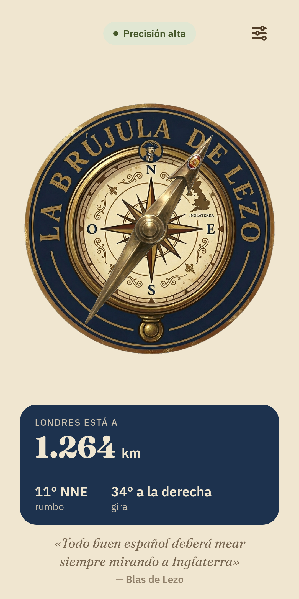
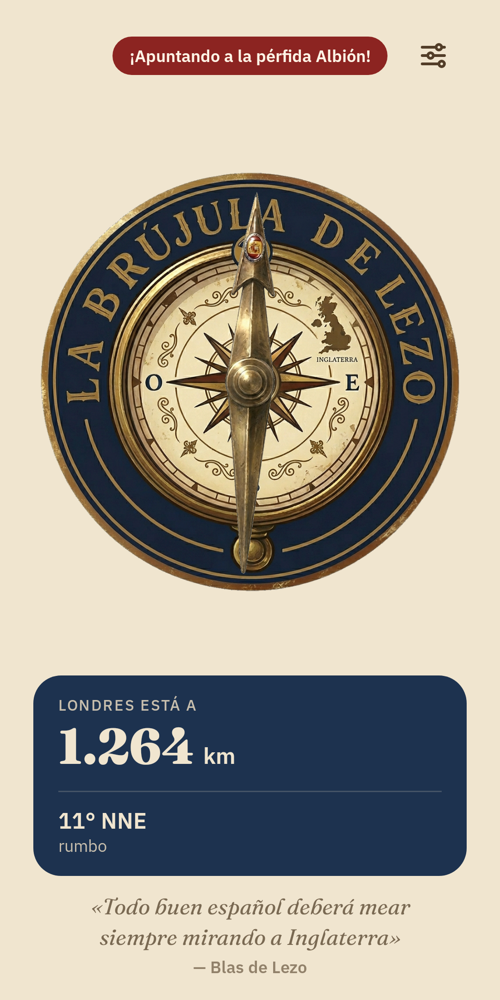
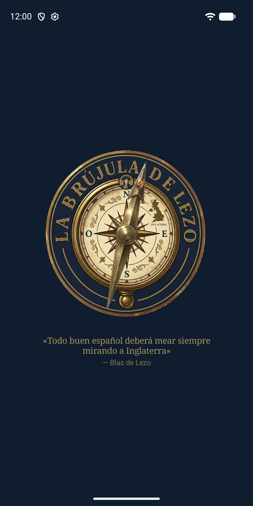

<p align="center">
  
</p>

[](https://github.com/parrazam/brujula-de-lezo/actions/workflows/android.yml)
[](https://github.com/parrazam/brujula-de-lezo/releases/latest)

> «Todo buen español deberá mear siempre mirando a Inglaterra»
> — *atribuido a Blas de Lezo*

Una brújula para Android que no apunta al norte. Apunta siempre a Londres.

🌐 [brujuladelezo.cuzo.dev](https://brujuladelezo.cuzo.dev)

---

## Qué hace

Gires como gires el móvil, la aguja señala la dirección real hacia Londres (51,51 °N, 0,13 °O). Aplica la declinación magnética de tu posición para que el rumbo sea geográficamente exacto. Además:

- Te dice a qué **distancia** queda Londres (en kilómetros o en millas náuticas), su **rumbo** («11° NNE») y **cuánto girar** para apuntar.
- Cuando apuntas a Inglaterra (±5°), aparece el aviso «¡Apuntando a la pérfida Albión!» y el móvil **vibra** una vez; se puede desactivar.
- Muestra la **precisión del sensor** y avisa cuando hay que calibrarlo.
- **Tema** claro, oscuro o el del sistema, con las fuentes Fraunces e IBM Plex Sans, e icono temático en Android 13+.
- Funciona con TalkBack: la rosa anuncia hacia dónde queda Londres.
- En tablets y plegables rota libremente y reorganiza la pantalla en dos columnas.

## Capturas

<p align="center">
  
  
  
</p>

## Tecnología

| | |
|---|---|
| **Lenguaje** | Kotlin 2.4.21 |
| **UI** | Jetpack Compose + Material 3 (Compose BOM 2026.06.01) |
| **Build** | AGP 9.4.1 (Kotlin integrado) + Gradle 9.8.2, JVM target 21 |
| **Arquitectura** | Clean Architecture multi-módulo |
| **DI** | Manual (`AppContainer`) |
| **Sensores** | `TYPE_ROTATION_VECTOR` + `GeomagneticField` |
| **Localización** | `LocationManager` (sin Google Play Services) |
| **SDK mínimo** | API 26 (Android 8.0) |
| **SDK objetivo** | API 36 (Android 16) |

## Arquitectura

Seis módulos Gradle con la siguiente jerarquía de dependencias:

```
app → presentation, data, domain, core, design-system
presentation → domain, design-system, core
data → domain, core
domain → core   ← Kotlin puro, sin Android
core            ← Kotlin puro, sin Android
design-system   ← Compose
```

| Módulo | Responsabilidad |
|---|---|
| `:core` | `DispatcherProvider`, tipos base |
| `:domain` | Modelos, interfaces de repositorio, casos de uso, `BearingCalculator`, `PointingHysteresis` |
| `:data` | `OrientationRepositoryImpl`, `LocationRepositoryImpl`, `GeomagneticRepositoryImpl`, `SettingsRepositoryImpl` |
| `:presentation` | `CompassViewModel`, `SettingsViewModel`, `CompassScreen`, `SettingsSheet` |
| `:design-system` | Tema Material 3, paleta del Siglo de Oro, tipografía, `CompassDial`, `StatusPill`, `HeroCard` |
| `:app` | `MainActivity`, `BrujulaApplication`, `AppContainer` |

## Cómo funciona la matemática

1. **Azimut del dispositivo**: sensor `TYPE_ROTATION_VECTOR` → `getRotationMatrix` → `getOrientation` → azimut magnético en `[0, 360)`.
2. **Norte verdadero**: `azimutVerdadero = azimutMagnético + GeomagneticField.declination`.
3. **Rumbo a Londres**: fórmula de círculo máximo → `atan2(sinΔλ·cosφ₂, cosφ₁·sinφ₂ − sinφ₁·cosφ₂·cosΔλ)`.
4. **Ángulo de la aguja**: `normalizeDegrees(rumboALondres − azimutVerdadero)`.
5. **Apuntando**: con histéresis, se entra cuando `|relativeAngle(rumbo, azimut)| < 5°` y se sale al pasar de 8°, para que el ruido del sensor no haga vibrar varias veces seguidas.
6. **Distancia**: haversine sobre el radio medio terrestre (6371 km).

## Desarrollo local

Requiere **JDK 21** y **Android SDK con API 36**.

```bash
# Compilar (variante debug)
./gradlew assembleDebug

# Ejecutar todos los tests unitarios
./gradlew test

# Lint
./gradlew lint

# Instalar en dispositivo conectado
./gradlew installDebug
```

## Tests

```bash
./gradlew :domain:test                      # rumbo, distancia, histéresis, rumbo cardinal, ajustes, caso de uso
./gradlew :presentation:testDebugUnitTest   # CompassViewModelTest, SettingsViewModelTest, DirectionFormatTest
./gradlew :data:testDebugUnitTest           # AxisRemapTest, LocationProvidersTest
```

Stack de test: **JUnit 4 + MockK 1.14.11 + Turbine 1.2.1 + `MainDispatcherRule`** con `UnconfinedTestDispatcher`.

## CI/CD

| Disparador | Pipeline |
|---|---|
| Push a `master`/`develop`, PR a `master` o `release/**` | `android.yml` → test + lint + assembleDebug |
| Tag `v*` | `release.yml` → assembleRelease + bundleRelease + firma + comprobación de 16 KB + GitHub Release con las notas del tag anotado |

Los artefactos de release se firman con un keystore codificado en el secret `KEYSTORE_BASE64`. Ver [`.github/workflows/`](.github/workflows/).

## Privacidad

- Sin acceso a internet: la app no pide permiso de red.
- Sin telemetría, sin analítica, sin anuncios.
- Permiso mínimo: `ACCESS_COARSE_LOCATION` — solo para calcular el rumbo, en memoria, sin almacenarlo.
- Lo único que se guarda en el móvil son los ajustes de la app (tema, vibración y unidad de distancia).
- Los sensores y la ubicación se sueltan en cuanto la app pasa a segundo plano.
- Las coordenadas de Londres están escritas en el código; no se descargan datos.

## Licencia

MIT © 2026 Víctor Parra
